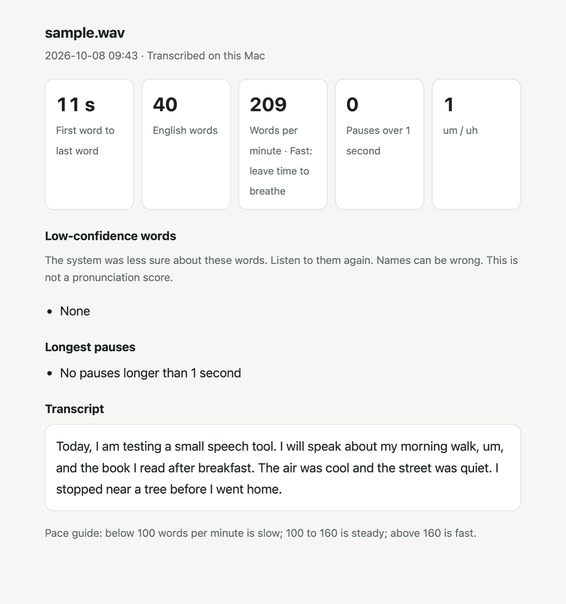

# SpeakFB

SpeakFB turns an English recording into a report on your speaking pace, your long pauses and your fillers such as `um`. It is a small command-line tool for macOS 26 or later on Apple silicon. Transcription runs on your Mac, and the tool does not upload recordings.

It does not score pronunciation. The report below is real output for an 11-second sample made with the macOS `say` voice.

<picture>
  <source media="(prefers-color-scheme: dark)" srcset="docs/report-dark.png">
  
</picture>

## What it measures

- Words per minute: words without fillers, from the first word to the last word. Pauses in this time are included.
- Pace: below 100 words per minute is slow, 100 to 160 is steady, and above 160 is fast. This is a simple guide.
- Pauses: gaps between words longer than 1 second. The report shows the five longest gaps.
- Fillers: `um`, `uh`, `er`, `ah`, `erm`, `hmm`, and `mm`.
- Low-confidence words: the system's confidence is below 0.5 and at least 0. Words must have at least three letters. Common words such as `the` and `and` are left out. The report shows up to 12 words.

Confidence shows how sure the system is. It is not a pronunciation score.

## Requirements

- macOS 26 or later on Apple silicon.
- Apple's command-line developer tools, with `swiftc` and `make`.
- Python 3. No Python packages are needed.
- ffmpeg. You can install it with Homebrew: `brew install ffmpeg`.

## Build

Keep both source files in this folder. In Terminal, run:

```sh
xcode-select --install
brew install ffmpeg
make
```

If the developer tools and ffmpeg are already installed, run only `make`.
The build uses `swiftc -parse-as-library -O` and runs with `nice -n 10`.
To choose a writable module cache:

```sh
make MODULE_CACHE="$TMPDIR/speakfb-module-cache"
```

## Use

```sh
python3 speakfb.py recording.m4a
python3 speakfb.py first.mp4 second.wav
python3 speakfb.py --locale en-US recording.m4a
```

The default locale is `en-US`. `--locale` changes the speech model's language.
The word, filler, and pace rules stay English. The system must support the locale you choose.
The Swift tool can also read a WAV file directly:

```sh
./speakfb recording.wav --locale en-US
```

With no file names, the Python tool reads new recordings from `~/SpeakFB/inbox/`:

```sh
python3 speakfb.py
```

The inbox accepts `.mp4`, `.mov`, `.m4a`, `.mp3`, `.wav`, `.aac`, `.3gp`, `.webm`, and `.caf` files.
Files with names already in the progress log are skipped. Use a file name on the command line to process it again.
The tool creates these data folders:

```text
~/SpeakFB/
  inbox/
  reports/
  progress.tsv
```

Each recording with English words adds one HTML report and one row to `progress.tsv`.
The last report opens in your browser. Set `SPEAKFB_NO_OPEN=1` to leave it closed.
Use `SPEAKFB_ROOT` to choose another data folder:

```sh
SPEAKFB_ROOT="$HOME/SpeechPractice" python3 speakfb.py recording.m4a
```

## Privacy

Transcription runs on your Mac. The tool does not upload recordings.
The system may download its speech model once for a locale. This first step needs a network connection.
Reports contain the transcript and the recording's file name. They stay in your data folder.

## Test

```sh
make test
```

This test uses macOS `say` to make a short English sample with one `um`.
It converts the audio with ffmpeg and runs the full Python and Swift pipeline.
It checks for one HTML report and one progress row. Test files are kept in the printed temporary folder.
A missing model or a system service error can stop transcription. The test records the error in `pipeline.log`.

Example result from this synthetic sample (a computer voice, not a person):

```text
sample.wav: 11 seconds, 40 words, 209 words/min, 0 long pauses, 1 fillers, 0 low-confidence words
```

## License and contributions

Copyright (c) 2026 Ninon.
This app uses GPL-3.0-only. Read [LICENSE](LICENSE).
Pull requests are welcome. Read [CONTRIBUTING.md](CONTRIBUTING.md) and [CLA.md](CLA.md).
